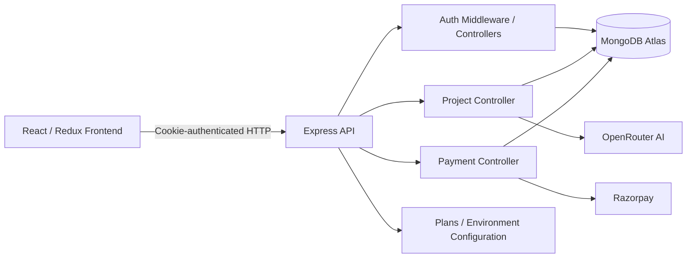
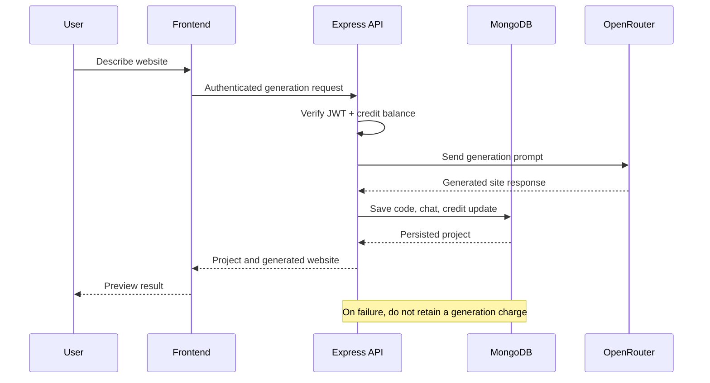
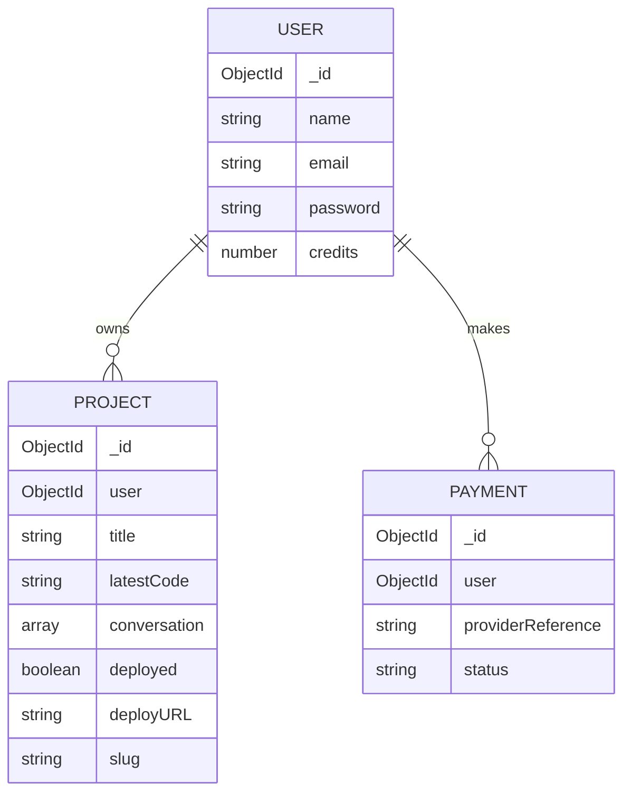
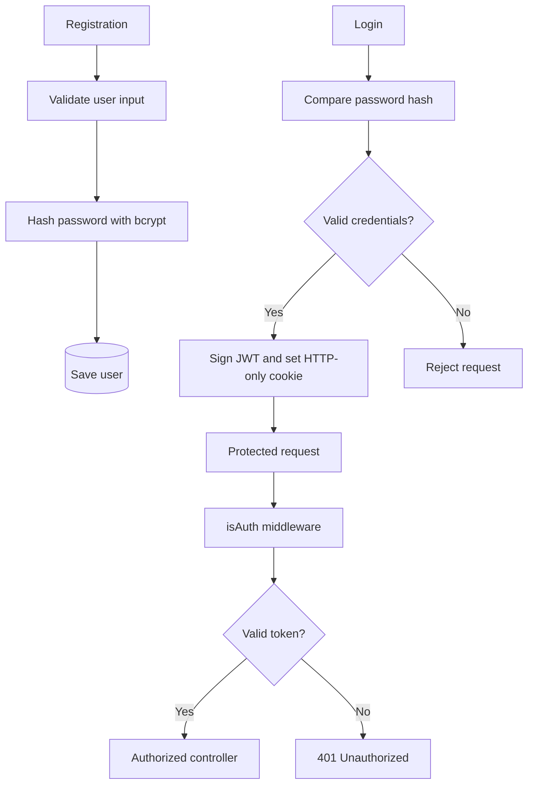

<div align="center">

# Webloom — Backend API

### The engine behind AI-powered website creation

**REST API for authentication, AI generation, projects, credit management, and payments.**

    

</div>

---

## Overview

The **Webloom API** powers a prompt-to-website workflow. It authenticates users using JWT cookies, persists website projects and conversations in MongoDB, requests AI-generated website code through OpenRouter, tracks generation credits, and includes Razorpay payment integration modules.


## Capabilities

- **Email/password authentication** using bcrypt password hashing and JWT.
- **HTTP-only cookie sessions** with middleware-protected endpoints.
- **MongoDB persistence** through Mongoose models for users, projects, and payments.
- **AI generation** through OpenRouter (`deepseek/deepseek-chat` was the configured model in development).
- **Project history** storing prompts, conversation data, and generated site code.
- **Credit system** with an initial 100-credit allocation and a 50-credit charge per successful generation in the previously discussed implementation.
- **Failure handling** designed to avoid charging for failed generations, including refunds where a debit happened before failure.
- **Plans and payments** with dedicated plan configuration, Razorpay setup, payment controller, and payment model.
- **Deployment fields/workflow** associated with project metadata; verify the current deploy endpoint before advertising production deployment as complete.

## System architecture



## Repository structure

```text
AI_Website_Backend/
├── src/
│   ├── config/
│   │   ├── database.js
│   │   ├── openRouter.js
│   │   ├── plans.js
│   │   └── razorpay.js
│   ├── Controller/
│   │   ├── razorPayment.js
│   │   ├── userAuth.js
│   │   └── websiteProject.js
│   ├── Middleware/
│   │   └── isAuth.js
│   ├── Models/
│   │   ├── payment.js
│   │   ├── project.js
│   │   └── user.js
│   ├── Routes/
│   │   ├── userAuthenticate.js
│   │   ├── userPayment.js
│   │   └── userProject.js
│   └── index.js
├── .gitignore
├── package.json
└── package-lock.json
```

## Technology stack

| Responsibility | Technology |
| --- | --- |
| Runtime | Node.js |
| HTTP server | Express.js (CommonJS modules) |
| Database | MongoDB Atlas, Mongoose |
| Password security | bcryptjs |
| Authentication | JSON Web Tokens, HTTP-only cookies |
| Cross-origin communication | CORS, cookie-parser |
| AI provider | OpenRouter |
| AI model used during development | `deepseek/deepseek-chat` |
| Payments | Razorpay |
| Environment variables | dotenv |

## Setup

**Prerequisites:** Node.js, npm, MongoDB Atlas access, and an OpenRouter API key. Razorpay credentials are required for payment functionality.

```bash
git clone <your-backend-repository-url>
cd AI_Website_Backend
npm install
```

Create `.env` in the project root. **Variable names below are a setup template; match them to the names read by your actual source files.**

```dotenv
PORT=4000
MONGO_URI=your_mongodb_connection_string
JWT_SECRET=replace_with_a_long_random_secret
OPEN_ROUTER_API_KEY=your_openrouter_key
FRONTEND_URL=http://localhost:5173
RAZORPAY_KEY_ID=your_razorpay_key_id
RAZORPAY_KEY_SECRET=your_razorpay_key_secret
```

> Do not commit `.env`, database credentials, API keys, or payment secrets. The actual MongoDB environment variable name may differ from `MONGO_URI`.

Start using the script defined in `package.json`, for example:

```bash
npm run dev
```

If no development script exists, start the entry point directly:

```bash
node src/index.js
```

The frontend expects the API at `http://localhost:4000` during local development.

## Request lifecycle



The AI output format used in development was a JSON object containing `message` and `code`, where `code` is a standalone HTML document with CSS and JavaScript. Output validation should occur server-side before saving and returning it.

## Data model overview



**Model diagram caveat:** `USER` and `PROJECT` fields reflect the development design; `PAYMENT` fields are conceptual placeholders until `Models/payment.js` is inspected. The diagram is architectural, not a guaranteed exact schema export.

## API surface

The following routes are **known from prior implementation discussions**:

| Method | Endpoint | Purpose |
| --- | --- | --- |
| `POST` | `/api/auth/register` | Register a new user |
| `POST` | `/api/auth/login` | Authenticate and set cookie |
| `POST` | `/api/auth/logout` | End session |
| `GET` | `/api/auth/me` | Return authenticated user |

The codebase also contains `Routes/userProject.js` and `Routes/userPayment.js`. Their exact route paths, methods, payloads, and response formats should be documented from those files rather than guessed.

### Authentication flow



## Credits and billing

The credit rules discussed during development are:

| Event | Credit effect |
| --- | ---: |
| New account | +100 credits |
| Successful website generation | −50 credits |
| Failed generation | No net charge |
| Plan purchase | Defined by `config/plans.js` |

The presence of Razorpay modules indicates a payment integration architecture. Verify order creation, server-side signature verification, webhook handling, and idempotent credit fulfillment in the code before accepting live payments.

## Deployment and security checklist

- [ ] Use strong JWT secrets and secure production cookie attributes.
- [ ] Configure CORS for the exact frontend origin with credentials enabled.
- [ ] Enforce project ownership on every read, update, delete, and deploy action.
- [ ] Apply rate limits to auth and AI-generation endpoints.
- [ ] Make credit debits and refunds concurrency-safe.
- [ ] Validate AI output and sandbox generated websites at render time.
- [ ] Verify Razorpay signatures on the server; never trust frontend payment status alone.
- [ ] Make payment fulfillment idempotent and audit credit transactions.
- [ ] Add request logging, tests, and monitoring.
- [ ] Check provider 429 handling, retry/backoff, and fallback configuration.
- [ ] Confirm production deployment route and generated-site hosting behavior.

## Planned improvements

- [ ] Add complete OpenAPI documentation for project and payment endpoints.
- [ ] Add automated tests for auth, credit accounting, and payment verification.
- [ ] Add resilient handling for OpenRouter rate limits and provider failures.
- [ ] Consider SSE streaming for conversational AI responses.
- [ ] Add production-ready website deployment and domain routing, if not yet complete.

## Related repository

**Frontend:** [Webloom React App](../AI_Website_Frontend/README.md) — landing pages, Studio, projects, auth state, and preview UI.

---

<div align="center"><strong>Webloom API</strong> · Secure infrastructure for creative ideas.</div>
